Graph Neural Networks are the state-of-the-art models for representation learning on graphs. **Message-passing** architectures have become dominant in this field thanks to their simplicity and their performance on graph tasks.

However, unlike their cousins in the neural-network family (CNNs, MLPs, Transformers), their expressivity is bounded by the Weisfeiler-Lehman test. In this post we first look at what the Weisfeiler-Lehman algorithm is, and why understanding it is essential to design better models and go beyond the limits of standard GNN architectures.

We then look at how recent GNN models manage to exceed the expressivity bound of the 1-WL test, and finally we discuss the expressivity of GNNs on dynamic graphs, a field that is still very little studied.

## Expressivity and the Weisfeiler-Lehman test

### The 1-WL test

**[The following figures are borrowed from M. Bronstein's blog post on the expressivity of GNNs](https://towardsdatascience.com/expressive-power-of-graph-neural-networks-and-the-weisefeiler-lehman-test-b883db3c7c49)**

The 1-WL test is a polynomial-time algorithm designed by Weisfeiler and Lehman in 1968 to determine whether two graphs are isomorphic. Two graphs are isomorphic when their structures are identical.

The test iteratively recolors the nodes of a graph.

For each node, we aggregate the colors of its neighborhood and recolor the current node with an injective hash function. We repeat this process until convergence (the color of each node no longer changes from one iteration to the next).

If two graphs are isomorphic, their colorings will be identical at the end of the process.

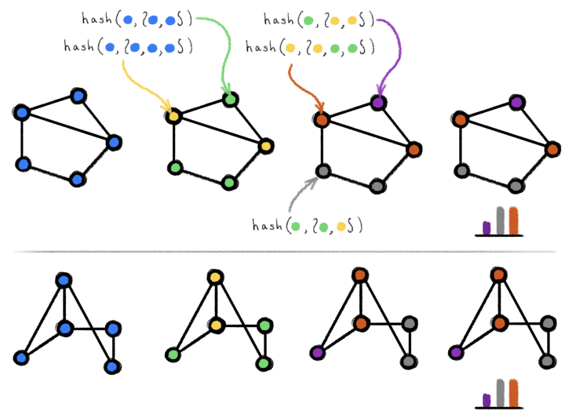

This algorithm distinguishes graph structures in **almost all situations**, with some exceptions such as regular graphs.

> _The WL test is based on iterative graph recoloring (a "color" in graph theory is a discrete node label), starting with all nodes having the same color. At each step, the algorithm aggregates the colors of nodes and their neighborhoods, represents them as multisets, and hashes the aggregated color multisets into new unique colors. The algorithm stops when it reaches a stable coloring. If at that point the colorings of the two graphs differ, the graphs are deemed non-isomorphic. If the colorings are the same, the graphs are possibly (but not necessarily) isomorphic. In other words, the WL test is a necessary but insufficient condition for graph isomorphism. There exist non-isomorphic graphs for which the WL test produces identical colorings and considers them "possibly isomorphic"; the test is said to fail in this case. Such an example is shown in the following figure:_

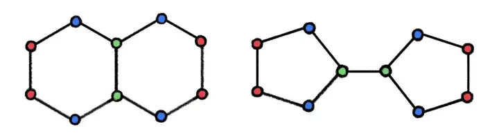

### How Powerful are GNNs? (2018)

_How Powerful are Graph Neural Networks?_ showed that standard message-passing architectures (GCN, GAT, SAGE) are bounded in expressivity by the Weisfeiler-Lehman test; moreover, in most cases these GNNs are much weaker than the 1-WL test at telling graph structures apart.

Being bounded means that graph structures that this test cannot distinguish cannot be distinguished by MP-GNNs either. In the paper, the authors then designed the most expressive MP-GNN, matching the 1-WL test: the **GIN** model.

For an architecture to be as expressive as the 1-WL test, some conditions must hold on the neighborhood aggregation and on the **readout** function.

**The readout function aggregates all node embeddings to produce a representation of the whole graph.**

An expressive GNN must never represent two different neighborhoods the same way, so we need an **injective** neighborhood aggregation function. The same holds for the **readout** function that produces the global graph representation.

**The goal is the following:**

$$
\text{Let } G_{1} \text{ and } G_{2} \text{ be two non-isomorphic graphs; a GNN } \mathcal{A}: \mathcal{G} \rightarrow \mathbb{R}^{d} \text{ should represent } G_{1} \text{ and } G_{2} \text{ differently,}
$$

whenever the Weisfeiler-Lehman test also determines that $G_1$ and $G_2$ are not isomorphic.

The authors introduce the following theorem. Let $\mathcal{A}: \mathcal{G} \rightarrow \mathbb{R}^{d}$ be a GNN. For any two graphs $G_1$ and $G_2$ that the WL test declares non-isomorphic, $\mathcal{A}$ maps them to different representations if the following conditions hold:

a) $\mathcal{A}$ aggregates and updates node representations as

$$
h_{v}^{(k)} = \phi\left(h_{v}^{(k-1)}, f\left(\{ h_{u}^{(k-1)} : u \in \mathcal{N}(v) \}\right)\right)
$$

where the functions $f$ (operating on multisets) and $\phi$ are injective;

b) the _readout_ function, operating on the _multiset_ of node representations, is injective.

### Going beyond the 1-WL test

**The k-WL test**

Recent research on GNNs has tried to exceed the expressivity bound of the 1-WL test.

The 1-WL test is limited and cannot capture simple graph structures such as closed triangles or cycles ([Can Graph Neural Networks Count Substructures?](https://arxiv.org/abs/2002.04025)).

The WL test can be generalized into a hierarchy of higher-order tests, known as the k-WL tests. This hierarchy has been used to characterize the expressive power of GNNs and to inspire the design of new GNN architectures.

In the k-WL algorithm (k > 1), we no longer color a node but a k-tuple of nodes.

For example, the 2-WL test no longer considers a node and its neighborhood but a pair of nodes. Instead of aggregating the colors of neighboring nodes (1-WL case), it aggregates the colors of neighboring triangles.

This lets the test describe more complex patterns, and so exceed the expressivity of the 1-WL test.

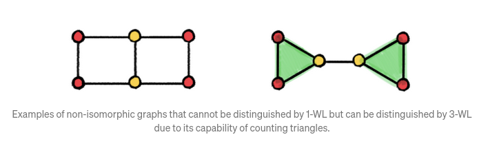

In the example above, the 1-WL test concludes the graphs are isomorphic, while the 3-WL test distinguishes them.

**Although more expressive, the k-WL test is far more expensive, since it considers every k-tuple of nodes in the graph, including non-adjacent ones.**

The video below helps understand the WL test and visualize the higher-dimensional cases.

[https://www.youtube.com/watch?v=YHeeAB_XRS4&list=PLeKJtN5YzWyPoNyqL34y5Jrag7aqgQRn5&index=10](https://www.youtube.com/watch?v=YHeeAB_XRS4&list=PLeKJtN5YzWyPoNyqL34y5Jrag7aqgQRn5&index=10)

A full playlist on graph isomorphism, the Weisfeiler-Lehman algorithm and graph transformers is available [here](https://www.youtube.com/playlist?list=PLeKJtN5YzWyPoNyqL34y5Jrag7aqgQRn5).

- Further resources on the WL algorithm and its adaptations in machine learning:
  - [**Weisfeiler and Leman go Machine Learning: The Story so far**](https://arxiv.org/abs/2112.09992)
  - [**A survey on the expressive power of graph neural networks**](https://arxiv.org/abs/2003.04078)
  - [**A Short Tutorial on The Weisfeiler-Lehman Test And Its Variants**](https://arxiv.org/abs/2201.07083)

**k-GNNs**

Contributions such as _[Weisfeiler and Leman Go Neural: Higher-order Graph Neural Networks](https://arxiv.org/abs/1810.02244)_ or _[Provably Powerful Graph Networks](https://arxiv.org/abs/1905.11136)_ design k-GNNs based on the k-WL test and reach the same theoretical expressivity. However, these techniques have a high memory and time complexity and are often impractical on large graphs.

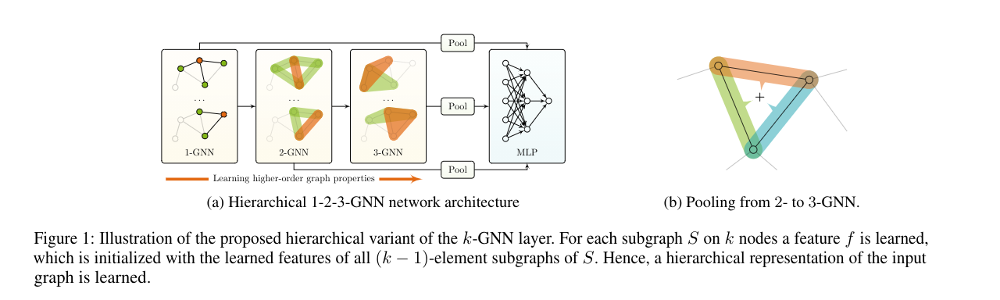

**Subgraph-based GNNs**

Decomposing a graph into several subgraphs processed by a GNN greatly improves model expressivity. Bouritsas et al. present a fast method that is more expressive than the 1-WL test: **[Improving Graph Neural Network Expressivity via Subgraph Isomorphism Counting](https://arxiv.org/abs/2006.09252)** (ICLR 2021).

A note on this paper is detailed in this post by M. Bronstein:

[Beyond Weisfeiler-Lehman: using substructures for provably expressive graph neural networks](https://towardsdatascience.com/beyond-weisfeiler-lehman-using-substructures-for-provably-expressive-graph-neural-networks-d476ad665fa3)

The idea is to treat messages differently, and explicitly, depending on the local structure of the graph. Messages go through additional functions describing the structure associated with each node, so messages coming from different structures are not aggregated the same way. This requires counting certain substructures; choosing these substructures injects an inductive bias that can greatly improve learning on some tasks (e.g. counting closed triangles in a social network, or cycles in protein interactions).

Their model **GSN** (Graph Substructure Networks) theoretically exceeds the expressivity of the 1-WL test while keeping locality and the same complexity **(during training)** as message-passing architectures, unlike the k-GNN methods discussed above.

Method:

The core of GSN is a preprocessing step that builds node features encoding predefined substructures of the graph $G$.

We first define a set of structures we want to identify in the graph:

$\mathcal{H} = \{H_{1},H_{2},...,H_{k}\}$

The set $\mathcal{H}$ contains substructures such as a 3-clique or a cycle of a given length.

For each $H$, we find the set of its isomorphic subgraphs in $G$, denoted $G_{S}$.

For each node $v \in V_{G_{S}}$, we infer its role in $H$ by getting the orbit of its mapping $f(v)$ in $H$, $Orb_{H}(f(v))$. By counting all possible appearances of the different orbits at $v$, we obtain the structural feature of $v$, $\mathbf{x}_{H}^{V}$.

The worst-case complexity of this preprocessing is $\mathcal{O}(n^{k})$, with $k$ the size of the substructures in $\mathcal{H}$.

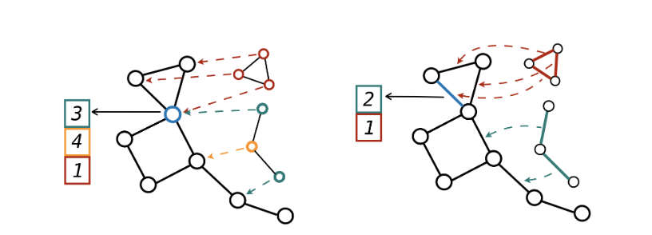

In the figure (left part), the neighborhood of the current node (blue) contains a 3-cycle (red), a 4-node pattern (yellow) and three paths of length 3.

The right part of the figure follows the same principle, targeting an edge instead of a node.

Message passing is defined as follows:

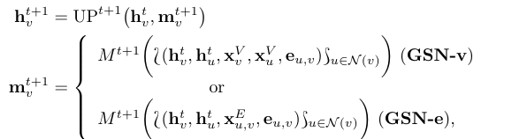

$M^{t+1}$ is a message-aggregation function (MLP, attention…) and $UP^{t+1}$ is the update function of the current node representation.

These are the same operations as in a standard MP-GNN. The two variants **GSN-e** and **GSN-v** count substructures around a target edge and around a target node, respectively.

**GSN is a message-passing GNN augmented with precomputed features that encode substructures in the local neighborhood of a node or an edge.**

The choice of substructures is crucial for the model to generalize well. Good prior knowledge of the graph distribution matters (for instance, favoring graphlets for protein interactions, and cliques and triangles for social networks). How to choose the substructures remains an open question.

A large part of the paper is devoted to GSN's expressivity: the authors prove that GSN is **at least** as expressive as the 1-WL test, and that, depending on the chosen substructures, it can reach the expressivity of the k-WL test.

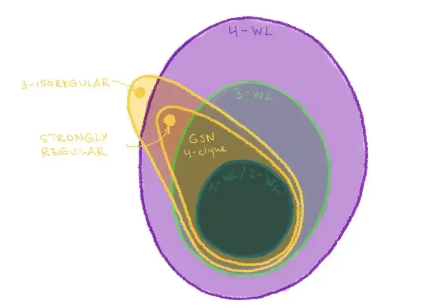

### Since GSN

**Based on M. Bronstein's blog post:**

[Using subgraphs for more expressive GNNs](https://towardsdatascience.com/using-subgraphs-for-more-expressive-gnns-8d06418d5ab)

GSN led to many contributions in the field of subgraph-based GNNs.

**Dropout**

It has been shown that subgraphs can be exploited to increase GNN expressivity through dropout, as in **[DropGNN](https://arxiv.org/pdf/2111.06283.pdf)** (NeurIPS 2021) or **[DropEdge](https://openreview.net/pdf?id=Hkx1qkrKPr)** (ICLR 2020). By randomly removing nodes from the graph during message passing, and repeating this dropout a number of times, we obtain several subgraph embeddings around a node.

This method does not require selecting substructures beforehand.

**GNNs and reconstruction**

_[Reconstruction for Powerful Graph Representations](https://arxiv.org/abs/2110.00577)_ (NeurIPS 2021) is based on the graph reconstruction conjecture.

> _Informally, the reconstruction conjecture in graph theory says that graphs are uniquely determined by their subgraphs._

The k-reconstruction GNNs proposed in this paper apply an MP-GNN to each induced subgraph of size k and sum the resulting embeddings. Since there can be too many such subgraphs, sampling is needed (similar to dropout GNNs).

**From stars to subgraphs**

_[From Stars to Subgraphs: Uplifting Any GNN with Local Structure Awareness](https://arxiv.org/abs/2110.03753)_ (ICLR 2022)

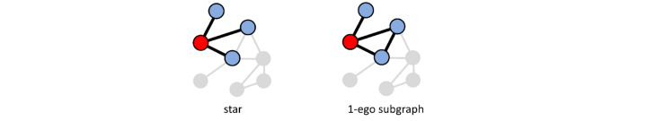

In MP-GNNs and in 1-WL, aggregation follows a star pattern. To extend this limited representation, Zhao et al. use **rooted subgraphs**.

Besides capturing neighborhood information like the star pattern (left), **rooted subgraphs** also capture its connectivity (right).

This way of aggregating a node's neighborhood is called **subgraph-1-WL**. The paper shows it is strictly more expressive than 1-WL and that it can distinguish some graphs that 3-WL cannot.

Subgraph-1-WL GNNs encode every subgraph with an MP-GNN.

Compared with dropout and reconstruction architectures, this method has the advantage of aggregating subgraphs that involve the same node several times.

**Equivariant subgraphs**

**[Equivariant Subgraph Aggregation Networks](https://arxiv.org/abs/2110.02910)**, ESAN (ICLR 2022)

Rather than encoding **multisets** of nodes as in 1-WL or MP-GNNs, they propose to encode a multiset of subgraphs.

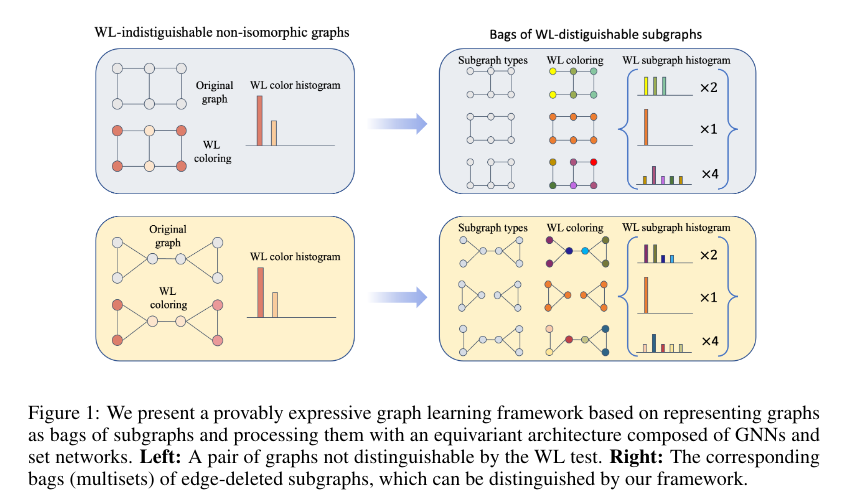

To build these multisets of subgraphs, they propose four selection policies:

- node deletion
- edge deletion
- two variants of ego-subgraphs (see the previous paragraph).

Their model is an equivariant framework to generate and process these subgraphs.

Why equivariant?

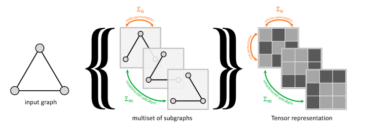

From the input graph (left), edge deletion can generate 3 subgraphs (middle), which leads to 3 different tensor representations, even though they are only permutations of the same subgraph pattern.

The equivariant framework aims to produce the same representation for each of these three using symmetry groups. ESAN builds on the work of [Maron et al.](https://arxiv.org/abs/2002.08599) (learning symmetric patterns).

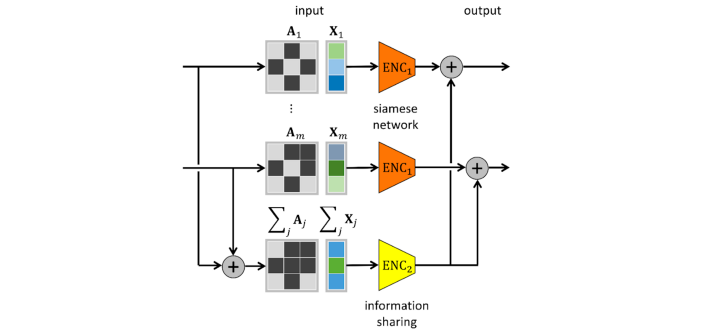

ESAN has two encoders (orange and yellow): the first encodes the subgraph structures in parallel with a Siamese network; the second, **information sharing**, aggregates (sums) the representation tensors of the different subgraphs. The orange encoder generalizes dropout- or reconstruction-style models, and the information-sharing module generalizes the stars-to-subgraphs approach.

**A key challenge for all these subgraph architectures is sampling: the space of subgraphs around a target node is often extremely large. So we must either predefine the structures (which requires prior knowledge of the graph distribution) or sample the subgraph structures (more or less cleverly).**

**[More recently (2022)](https://towardsdatascience.com/graph-ml-in-2023-the-state-of-affairs-1ba920cb9232#8e6c)**

> _Among architectures more expressive than 1-WL, subgraph GNNs are the biggest trend. Several approaches stand out:_
>
> 1️⃣ [Subgraph Union Networks (SUN) by Frasca, Bevilacqua, et al.](https://arxiv.org/abs/2206.11140) provide a full analysis of the design space and expressivity of subgraph GNNs, showing they are bounded by the 3-WL test.
>
> 2️⃣ [Ordered Subgraph Aggregation Networks](https://arxiv.org/abs/2206.11168) (OSAN) by Qian, Rattan, et al. design a hierarchy of subgraph-enhanced GNNs (k-OSAN) and find that k-OSANs are incomparable to k-WL but strictly bounded by (k+1)-WL. A particularly cool part of OSAN is the use of [Implicit MLE (NeurIPS'21)](https://arxiv.org/abs/2106.01798), a differentiable discrete sampling technique, to sample the ordered subgraphs.
>
> 3️⃣ [SpeqNets](https://arxiv.org/abs/2203.13913) by Morris et al. design a permutation-equivariant hierarchy of graph networks that balances scalability and expressivity.
>
> 4️⃣ [GraphSNN](https://openreview.net/pdf?id=uxgg9o7bI_3) by Wijesinghe and Wang derive expressive models from the overlap between subgraph isomorphisms and subtree isomorphisms.

## Expressivity of dynamic GNNs

## Provably Expressive Temporal Graph Networks (NeurIPS 2022)

### Context

This paper studies the expressivity of TGNs (Temporal Graph Networks) by grouping them into two families: TGNs that aggregate temporal random walks, **WA-TGN** (CAW), and models built on message passing, **MP-TGN** (TGN, TGAT, JODIE…). In both cases the paper considers continuous-time dynamic graphs (**CTDG**); discrete-time graphs (DTDG) can be directly converted into CTDGs.

**Reminder: state-of-the-art TGN architectures on CTDGs**

MP-TGN family:

- **[Know-Evolve / temporal point processes](https://arxiv.org/abs/1803.04051)**: approaches based on temporal point processes (TPP), parameterized by a neural network (RNN).
- **[JODIE](https://arxiv.org/abs/1908.01207)**: an RNN approach where nodes are updated with a time-series model. In the bipartite case, two RNNs are used (users and items). A temporal projection updates a node's memory; if a node has not been involved in any event for some time, its memory is considered stale.
- **[TGAT](https://arxiv.org/abs/2002.07962)**: the first architecture to use time embeddings. During message aggregation, a time embedding (Time2Vec) represents the time elapsed between the present time t and the last interaction with the neighbor. The aggregation function is similar to GAT (attention weights over neighbors). The aggregated GNN layers Z(t) are then linearly projected into queries, keys and values, as in transformers.
- **[TGN](https://arxiv.org/abs/2006.10637)**: a generic message-passing framework. On top of TGAT, TGN-attn uses a memory module for message passing and node updates, and also uses Time2Vec during message aggregation.

WA-TGN family:

- **[CAW-N](https://arxiv.org/abs/2101.05974)**: generates anonymous (important for the model to be inductive) and causal random walks. Starting from a target edge (u, v), it samples random walks to find the nodes responsible for creating this link. The walks are encoded with an RNN, which forms the representation of the link only.

The goal of this work is to extend the study of static GNN expressivity (GIN, _How Powerful are GNNs?_, links to WL-based algorithms…) to temporal graphs, by defining a temporal 1-WL test.

After studying the expressivity of temporal GNNs, the authors propose a new architecture, **PINT**. Using injective temporal message passing and **relative positional features**, they show large gains over existing architectures while matching the expressivity of the temporal 1-WL test.

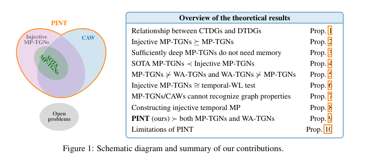

### Isomorphism in temporal graphs

The expressivity of TGNs is evaluated by their ability to tell apart non-isomorphic structures in the graph. Two nodes that do not share the same local structure, or did not connect to their neighborhood at the same time $t$, should not get the same representation.

To measure the expressivity of an MP-TGN, we evaluate its ability to map two distinct nodes to different points of the embedding space:

$u\text{ and } v \text{ are different, so } h_{u}^{(L)}(t) \neq h_{v}^{(L)}(t).$

The computation of a node $v$'s representation at time $t$ can be described with a TCT (**Temporal Computation Tree**), denoted $T_{v}(t)$.

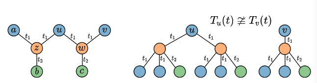

The TCT is a computation tree induced from a source node.

On the left is a temporal graph: colors are node _features_, and $t_{1},t_{2}$ are the times at which nodes connect. On the right are the depth-2 TCTs of nodes $u$ and $v$.

If an MP-TGN of depth $L$ gives different representations to $u$ and $v$, then $T_{u}(t)$ and $T_{v}(t)$ are not isomorphic.

In the example above, models such as TGN-attn or TGAT cannot distinguish $T_{u}(t)$ from $T_{v}(t)$. Both use the mean of messages as aggregation function; since the proportion of _features_ is the same in both cases, both models give $u$ and $v$ the same representation.

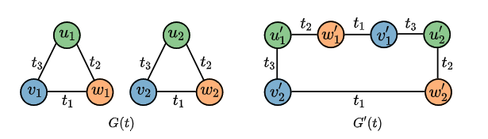

Simple structures such as cycles or cliques cannot be modeled by current MP-TGNs or WA-TGNs, even when the MP-TGN is as expressive as the temporal 1-WL test.

The paper also discusses MP-TGNs with a memory module, showing that if the TCT depth is smaller than the number of layers $L$, the memory module does not improve the model's expressivity.

**Extending 1-WL to the temporal case**

1-WL is an isomorphism test on static graphs based on iterative node recoloring: at the end of the process, if two graphs have the same coloring, they are (**possibly**) isomorphic.

This algorithm extends to temporal graphs by viewing the dynamic graph as a multigraph (several links possible between two nodes).

### The PINT model

The authors present PINT (**p**osition-encoding **in**jective **t**emporal graph net). The model has two components:

1. Injective message aggregation and representation updates in a temporal setting.
2. Positional _features_ generated from the TCTs.

**Injective aggregation**

As in GIN, the best way to maximize the expressivity of MP-TGNs is to use injective aggregation functions. On dynamic graphs, it matters when links were created between two nodes. A common inductive bias is to give more weight to recent events (TGN, TGAT).

$$
\tilde{h}_v^{(\ell)}(t)=\sum_{\left(u, e, t^{\prime}\right) \in \mathcal{N}(v, t)} \operatorname{MLP}_{\mathrm{agg}}^{(\ell)}\left(h_u^{(\ell-1)}(t) \| e\right) \alpha^{-\beta\left(t-t^{\prime}\right)}
$$

As injective functions they use MLPs, as in GIN (universal approximators of continuous functions).

To give more weight to recent events, PINT uses an exponential time decay, $\alpha^{-\beta(t-t^{'})}$, where $\alpha$ and $\beta$ are hyperparameters.

$$
h_v^{(\ell)}(t)=\operatorname{MLP}_{\mathrm{upd}}^{(\ell)}\left(h_v^{(\ell-1)}(t) \| \tilde{h}_v^{(\ell)}(t)\right)
$$

The update function must also be injective to maximize expressivity; $\|$ denotes vector concatenation, and $h_{v}^{(0)} = s_{v}(t)$ is the state vector of node $v$.

**Relative positional features**

The authors propose to augment the state vector $s$ of each node with relative positional features.

The idea is to count how many temporal walks of a given length exist between two nodes (how many times nodes appear at different levels of the TCT).

We consider a square matrix $P$; each row gives the relative position of every node with respect to the target node.

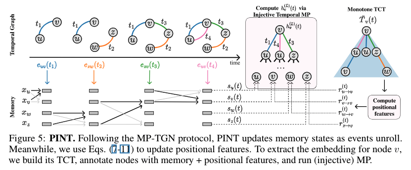

**PINT** with positional **features** is strictly more expressive than WA-TGNs and MP-TGNs.

**Limits of PINT**

PINT is bounded by the temporal 1-WL test: any non-isomorphic structures that T-1-WL deems isomorphic cannot be distinguished by PINT either.

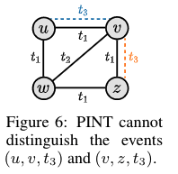

Because of the symmetry of this graph, PINT cannot give different representations to these two events. So there is still room to improve the expressivity of TGN models.

## Results

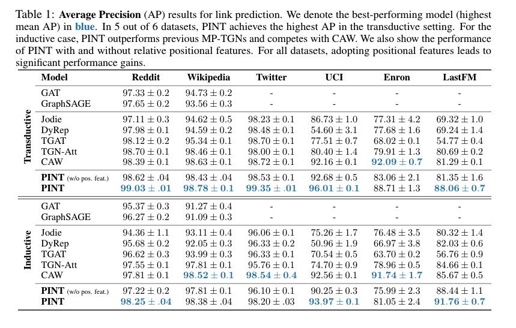

The experimental protocol used here is the same as in TGN, TGAT, CAW… It would be interesting to evaluate PINT with the new protocol introduced at NeurIPS 2022, **[Towards Better Evaluation for Dynamic Link Prediction](https://arxiv.org/abs/2207.10128)**.
